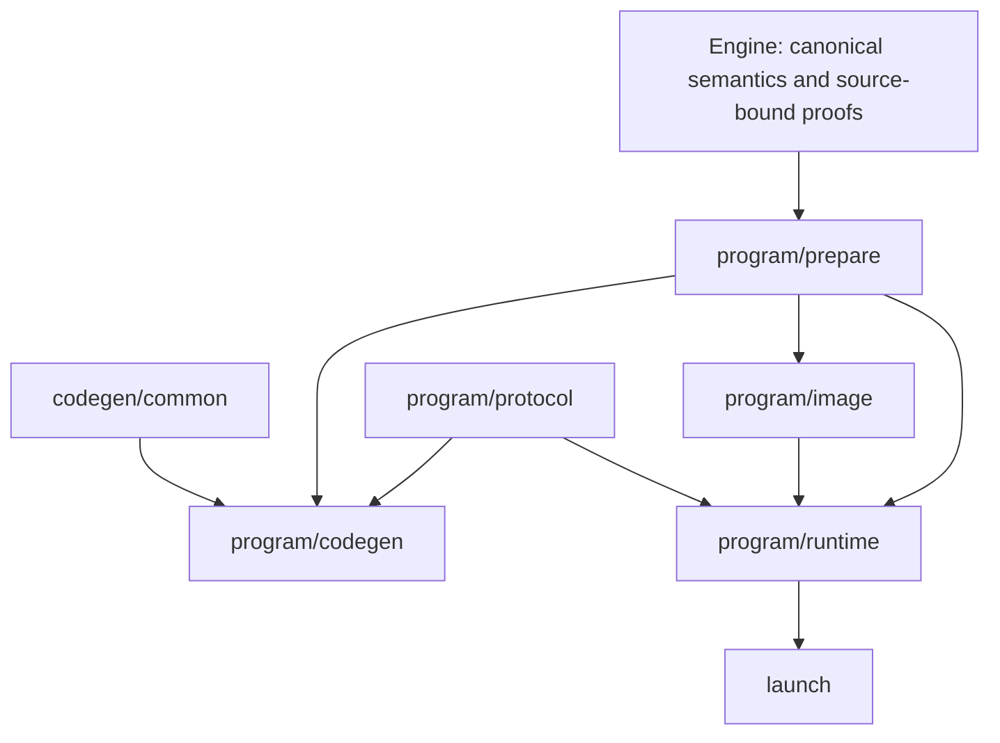

# Native compiler consolidation

This is the implementation contract and migration ledger for the consolidation
above PR #934. The public source/bytecode → canonical `ProgramArtifact` → checked
native plan → shared JIT/Object definition path remains authoritative. Supported
scalar, match, iteration, managed, hosted, benchmark-policy and source-native
entry points remain supported. No stack is merged by this work.

## Fixed baseline and evidence

The handoff proposed I = `96e535307b30a69fa2dc8dd48c2192089e2361ea`.
Before any primary measurement, adopt I =
`ddf8cbc3b17a644ea6292ee3bf0c4a9c63af4514`, PR #934's repaired head.
This preserves all optimization commits, the merged #901–#910/#929 integration
changes and the subsequently verified CI repairs. Earlier source and executable
receipts remain historical evidence. This I is fixed throughout the campaign;
F/I measures only the architectural consolidation above that adopted base.

W remains `d8d9a7d64944cd3de78fe3f8190284924069c508`. Its retained executable
SHA256 is `43ec6990256fec678e99bc7726ce2f203a4191154e19963fee4a43b355fc70ca`;
its object SHA256 is `a45687cbcb1d8824a1de595545192e14b075462e309cbd3796286f04b1667f4c`.
Historical evidence is benchmarks commit
`0014c0b238f43175c1993ad53f3467e2545c1a93`, under
`experiments/mech/native-owner-aot-v1/`. Historical results qualify W only.
No timing result, test count, or ABI/resource equivalence is inferred for I or F.

The final evidence study is `native-architecture-consolidation-v1/` in that
benchmark root. The two-session, four-subject Williams schedule, seed
2026102595, 20,000-resample paired median log-ratio analysis, and upper 95%
interval gates (F/I < +1%, F/W < +1%, F/R < 0%) must be committed before samples.
Absent the exact retained W/R binaries or recorded machine, performance remains
unqualified; substitutes must never be relabeled as retained controls.

## Dependency and authority graph

Engine proofs have private constructors and no public Deserialize. Read-only
same-plan facts share graph primitives, not consumer eligibility. Runtime image
restoration is an independent checking boundary; neither a serialized proof,
codegen report nor numeric footprint grants execution authority. Runtime-only
code never imports Cranelift, JIT, Object emission or parsing. Common emission
never depends on a packed-map strategy. Session orchestration never probes maps
or performs compiler analysis. Representation modules never own global dispatch.

## Preparation and work

One owned `PreparedNativeProgram` holds `ProgramMetadata` and complete
text-line frontiers. Its private fields are exposed by typed shared accessors.
CodePlan keeps distinct scalar and prepared-program variants. Emission borrows
preparation; descriptor finalization hashes complete inventories, then moves
metadata without cloning the plan. Source-backed reconstruction uses the same
preparer; build-owned restoration does not rerun it or bind calls twice.

The ordered recipe is: revision/current-visit validation; aggregates;
parallel/retirement; completion allowance; borrowed strings; string-map inventory
and selected joins; line matrices; body/charged visits and join funding; complete
frontiers and prefix; borrowed/prefix work; map-owner facts/work; closed tails/work;
map admission; actual selected-call binding/query stages; window inventory;
frame prefix/one owner relocation; frozen maps; types/constants/ownership bounds.
Compile host/target and bounded counts are checked before substantial preparation.

Three quantities remain distinct:

- Analysis visits have zero completion **base**; selected joins may add 64 there.
- Charged visits have completion base `64 * outputs + 8 * iterations + 256`,
  plus existing ordered source-bound supplements.
- Emitted instruction bounds preserve primitive precedence, helper operands and
  borrowed/tail/prefix additions; they are not charged runtime work.

Checked addition and validation order remain explicit. Completion sites never
enter map admission. Frame assignment retains scalar + iteration + aggregate +
borrowed + closed words, then relocates owner words once. Unselected frontiers
remain in the identity transcript.

## Runtime and protocols

One ExecutionState owns control, arena, collections/maps, retained calls,
caches, stats and cursors. ControlState is shared mechanically with iteration
execution. Invocation borrows state and disjoint transport lanes synchronously.
`Prepared.state` remains optional: take before admission, invoke, validate and
clear loans, restore the same state only on success. Every error after take is
terminal. No restore-on-error guard, state clone, lock, RefCell or guest dispatch
is introduced. Drop map/line/collection owners before arena, and backing before
the reservations paying for it. Mutable frame-lane references never span native
execution. Packed frames retain stable Box addresses and refreshed export slots.

Map Slot keeps its three Option-backed fields and existing charged envelope.
Named transitions represent Vacant, Retained, Closed, FrozenPending and
FrozenPublished; terminal cleanup-only partial storage never resumes. Closed map
modes 0/2/3 remain distinct from scalar tail modes 1/4. `has_retained_binding`
preserves the former `active` predicate; occupied and active-table counts differ.

Global helper tags and closed-owner operations have separate typed domains.
Owner IDs 0–14, global IDs 0/1/2/output range and MAX-1 through MAX-25 retain
numbers, ignored lanes, debit/validation order and error origins. MAX-15 is live
StructuralObservation. Naming tags grants no new precise memory-effect proof.

Descriptor serialization remains explicitly flat. Preserve image format
`mech.build-owned-native-descriptor` v1, typed IR 94, work 69, program ABI 33,
192-byte identity, offsets 112/120 for same-Object footprint and all frame
offsets/symbols. `constant_admission_bytes` remains a recomputed nonserialized
cache. Proof DTOs belong to image/wire, with independent frozen-map and
selected-join association checks. No version bumps or resource repricing.

## Migration/deletion ledger

| Stage / authority | Current and duplicate owners to replace | Production callers / feature scope | Required evidence / final owner |
| --- | --- | --- | --- |
| B preparation | `iteration_compiler::define_cfg` setup; `NativeProgramDescriptor::prepare`; layout aggregate/owner rediscovery | Program JIT, Object, `program_linked::prepare_descriptor`; program runtime/compiler | One `program/prepare`; source/decoded/image metadata, identity/frame/work agreement; delete both old recipes |
| B cost/frame | compiler zero-completion loops; descriptor charged-completion loops; owner relocation in both | same as preparation | One ordered composition, distinct visit views; emitted bounds unchanged; delete duplicate loops |
| C graph facts | host parallel traversals and engine `fusion_semantics`/private `ValidationInputs` primitives | engine validation/lowering, host layout; runtime preparation | Opaque same-plan facts; counts-first/lazy first errors; role-specific reads/barriers |
| C aggregate emission | `program_scalar_aggregates`; packed-loop aggregate bodies and neutral helpers | memory scalar, SSA scalar/packed codegen; compiler only | `codegen/common`, static WordAccess; overlap, tag/origin and actual-pass ablations; delete duplicate bodies/imports |
| D controls/report | TLS disable flags and `take_*_emissions` | all codegen passes and ablation tests; compiler only | explicit options plus bounded actual-emission report; nested/concurrent isolation; delete TLS/wrappers |
| E execution/stats | `program_runtime::Context`, OwnedState, session transfer mirrors | normal/paused/worker sessions; program runtime | one state/stats owner and borrowed invocation; terminal errors/drop/resource frontiers |
| E control | iteration Context ledger and program/session mirrors | scalar iteration and program hooks; runtime | shared ControlState/View; exact visit/error/order behavior |
| E map lifecycle | scattered Slot field transitions | retained/closed/frozen callers; runtime | maps owner methods with unchanged backing/size; one-short failures, publication/retirement |
| E protocol | `program_abi`, global runtime dispatch, closed owner/codegen numeric tags | every generated helper and synchronous callback | typed `program/protocol`; unchanged ABI, lanes and conservative effects; delete duplicated raw dispatch |
| F launch | repeated scalar/match/iteration and hosted generated main bodies | public generators and generated processes | compiled `launch`, narrow unsafe build binding; runtime closure, all template/public-process tests |
| G namespaces | flat `program_*` module paths | mod/cfg/static CI/unsafe declarations/test paths | move consolidated owners in same commits as path guards; delete temporary private bridges |

Each implementation commit updates this ledger's evidence; pending work is not
completion. No supported alternate API is a deletion target.

## Feature matrix and verification

| Feature | Permitted responsibility |
| --- | --- |
| no default features | no canonical compiler/runtime dependencies |
| canonical-native-runtime | scalar/match/iteration ABI, linked runtime and compiled family launch |
| canonical-native-program-runtime | preparation, image restoration, program state/protocol; no compiler/parser |
| canonical-native-program-host-runtime | hosted resources/provider launch; no resident routing/compiler/parser |
| canonical-native / canonical-native-program / program-host | compiler/JIT/Object and corresponding build/generation APIs |
| optional benchmark policy / native-source | retained separate adapters, never public canonical fallback |

Use pinned nightly-2026-03-03, locked offline dependencies after fetch. Baseline
and final inventories enumerate ignored cases, and execution reports actual
nonempty selections. Retain native unit, native_text_line, workers and catalog
scopes; six scalar-family integration suites and managed Program; source map
contracts; four independent minimal feature checks and dependency inspection.
Reusable fixtures remain small; contract tests stay beside their owner.

Public CLI and hosted qualifications use the existing bounded CI scripts and
saved/pinned harnesses in ci-native-plan.yml. Execute all five CLI unit cases,
all three ignored public-process cases and the ignored original/decoded hosted
process case with their negative controls, receipts and completion checker.
Compare representative emitted guest instruction bodies and resource/identity
outputs with I, not whole host executable bytes. Final changed-input oracle runs
the same exact F and I executables on all seven retained changed inputs.

## Implementation receipts

Stage A fixes I before any samples. At I the current native scope executed
415 passes, 0 failures and 2 existing ignores. These are measured counts, not
copied historical counts. The public CLI built a runnable I AOT executable;
its bytecode is `050db3a016f0caea04900d48940db5bbefc880c3ada507eff82c22c5b84418b0`
and its object is `a45687cbcb1d8824a1de595545192e14b075462e309cbd3796286f04b1667f4c`,
identical to W's retained guest object. Exact W/R executable hashes were verified
without rebuilding either. Benchmark evidence starts at `0ed869eb0` on
`codex/native-architecture-consolidation` in mech-lang/benchmarks.

Stage B replaces the descriptor and compiler preparation recipes with
`program/prepare::PreparedNativeProgram`. Program CodePlan borrows that object;
source-backed linking shares the constructor, while image restoration assembles
metadata through private format DTOs and retains its independent frozen-map and
selected-join checks. Metadata is moved into the descriptor. Flat public
serialization preserves all 25 fields and their order. Complete frontiers and
the string-map inventory are shared with identity, with no hash transcript change.
One ordered supplement composer preserves separate analysis/charged views.
Frame-prefix arithmetic and final local-word lookup have one owner. Static
emission-template bounds remain a separate compiler quantity.

The post-preparation native scope executed 415 passes / 0 failures / 2 ignores.
The subsequent wire/frame changes passed all four existing identity-inventory
checks. The final source/decoded snapshot selection executes one test over four
fixtures: all 32 object/metadata/image/bytecode files match I byte-for-byte.
Program runtime-only compilation, all 90 workflow contracts, unsafe ownership,
warning policy, planning quarantine and build-analysis layout checks pass.
No replaced API is retained as a second preparer. Definition phase extraction
continues alongside explicit compiler context work; the shared JIT/Object path
has not been split into different emitters.

The receipts below record the later stages. Final qualification remains open
until the prescribed final evidence exists.

Stage C emission: `codegen/common` owns SSA homes, static WordAccess adapters,
Pack/Copy/Project/Observe and ordinary source terminators. Both aggregate bodies
are replaced, including overlap-safe reads before writes. Checked guards emit
the existing checks; packed strategies consume current-site facts and retain
reporting. The scalar strategy uses the shared tag graph directly, with no
packed-emitter import for neutral helpers. The native scope executes 415 passes,
0 failures and 2 existing ignores; all 32 source/decoded snapshot files remain
byte-identical to I. Engine facts work continues separately in this stage.

Baseline feature-closure finding: the independent scalar runtime-only check
fails at I because `ResidentBudgetMeter::for_native_projection` is compiled
without any production projection consumer. The same check reproduced the
failure in the unchanged I checkout. Gate that private constructor with its
existing text/map consumers (or tests); its body, prices and supported features
are unchanged. I remains fixed and its runnable public AOT control is preserved.

Stage C facts: engine `NativeProgramFacts` is constructed only by the borrowed
plan. Shared SemanticInputs keeps validation counts first and action expansion
lazy; validation has its own fresh instance and no validated flag. Facts expose
control edges/predecessors/reachability, strict dominance, lexical ancestry,
producer roles and detailed read roles. Parallel transition/purity policy remains
explicit and distinct from fusion reads. Its producer whitelist still excludes
builder and virtual-consumer roles. Engine aggregate, map-owner and retention
queries reuse same-plan semantic inputs and aggregate inventory; preparation
moves the aggregate/frontier inventories out without cloning a plan or boxed
metadata. Current-visit validation is never replaced with whole-graph dominance.

Verification: 10 fusion/first-error/facts tests, all 84 engine native-artifact
tests, 30 native line tests, 16 parallel execution tests and four independent
identity-inventory tests pass. Source/decoded snapshot outputs still match all
32 I files. Scalar runtime-only and program runtime-only checks now pass; the
former also exposed an unused `NativeTypedStorage::admission_bytes` helper in
I's scalar profile, now gated to its existing program/test callers. No helper
body or accounting price changed. The other minimal closures and final process
qualification remain required after all stages.

Stage D: each shared JIT/Object definition receives immutable
`OptimizationOptions`; public entry points supply the fixed default. Private
tests disable one pass per build. The compiler context owns bounded selection
budgets independently from `CodegenReport`; reports record actual emissions and
cannot authorize eligibility. All compiler TLS switches and draining counters,
including disjoint/nontrapping home experiments, are deleted. Read-only test
summaries come from the artifact's bounded report. Default source/decoded
snapshots retain all 32 I files byte-for-byte. The full ablation scope and the
new nested/concurrent context test are running; final qualification remains open.

Before Stage E, actual pinned-host layouts are Invocation/Context 2432 bytes,
Frame 144 bytes, and map Slot 968 bytes. The fixed caller price is 2432 + 144 +
128 = 2704; keep that charged envelope after grouping state and retain the
three Option-backed Slot fields. The layout extraction must fit the existing
128-byte conservative margin without repricing or moving finite frontiers.

Stage D completion evidence: nested/default/concurrent Object compilations have
isolated options, reports and identical bytes for equal options. The native run
completed 415 passes, two existing ignores and one report-summary assertion
failure (a direct lookup callee was counted as a second top-level steady loop).
The summary now retains the existing non-direct definition meaning; the actual
emission/metadata and guest bytes did not change. Its focused regression passes.
Final native qualification after runtime extraction remains required.

Stage E ownership: `ExecutionState` owns one ControlState, one RuntimeStats,
arena, owners, caches, library ledger and publication cursor. Invocation borrows
that same local state plus disjoint transport/progress for a synchronous phase;
ControlView borrows the shared ledger mechanically in both iteration and
program execution. The mirror OwnedState and both field-transfer literals are
deleted. State is taken at the existing boundary and restored only after all
successful phase checks and the Invocation has dropped. An error never restores
it. No allocation, lock, dynamic dispatch or self-referential owner was added.

The new persistent state is 1104 bytes and invocation 1288 (2392 combined),
within the previous 2432 + 128 allowance. The caller charge remains 2704 bytes
and Frame remains 144. Slot remains 968 bytes. The layout guards, shared control
progress regression, malformed checkpoint regression and corrected steady
report regression pass. Slot lifecycle/protocol consolidation continues next.

Stage E lifecycle/protocol: unchanged three-Option Slot backing now has named
install/take/freeze/publication transitions and a borrowed diagnostic SlotPhase
covering Vacant, Retained, Closed, FrozenPending, FrozenPublished and terminal
partial storage. The generated-entry observers inspect real phases; injected
counter overflow after frozen token assignment observes a cleanup-only partial
state and complete owner retirement. `has_retained_binding` retains the former
`active` meaning; active_tables updates and closed callback restoration order
are unchanged. Closed maps still reject suspend modes 1/4; scalar tail modes
remain separate. Read/copy, retirement and retained/closed admission have named
lifecycle entry points.

GlobalHelper and OwnerOperation are separate typed domains. Codegen's global
and bound-call APIs cannot exchange them. Encoders retain every u64 number;
classification at runtime rejects nothing ahead of current site/phase/admission
checks. Unknown Owner values retain the original late key/error checks. The
live structural observation is named, output construction is checked, ignored
lanes and conservative 13/14 effects are preserved. No unchecked enum cast is
used. All source/decoded guest objects, metadata, images and bytecode still
match 32 baseline I files. The full native scope executes 418 passes, zero
failures and two existing ignores; focused owner/frozen/effect tests execute
15 passes. Scalar-only compiler compilation now passes after retaining the
existing program-only report/flag gates. Final feature/process/performance
qualification remains pending.

The independent Stage E minimal closures all pass: no native features, scalar
runtime, program runtime and hosted program runtime. The scalar compiler-only
closure also passes. Two remaining raw tag aliases are scoped to their
codegen/test consumers; runtime dispatch uses the typed protocol directly.

Stage F: compiled `launch` modules own scalar-family argument parsing,
evaluation/formatting, managed qualification I/O, and secured hosted lifecycle.
The generated mains contain only same-Object symbol/image bindings, maintained
catalog installation and typed dispatch. Private binding fields require the
existing unsafe checked-build provenance contract; public run functions do not
authenticate arbitrary pointers. Image/identity and resource admission checks
still run independently. The hosted runtime owns its terminal/provider
dependency; base program-runtime does not acquire it. Secured and optional
benchmark launch schemas stay separate even when Cargo unifies features.

All eight retained acquisition/argument/drop tests now run as compiled library
tests. The additional feature-unification schema regression passes (nine total
in that profile). Generated-process qualification requires the exact eight
compiled test names and one nonempty complete summary, and retains its actual
application launches and pin-rejection builds. The qualifier's negative/empty
selection contract passes. CI source pins include the compiled launcher owner.
The six scalar-family integration suites execute 44 passes, zero failures and
one existing ignored linked-process case. All four independent minimal library
checks pass, as does the optional benchmark runtime check; 90 workflow contracts,
unsafe-boundary and warning-policy checks pass. Runtime-only *library tests*
expose inherited compiler-only test imports, so the bounded eight-test launcher
qualification uses the maintained host compiler test profile while runtime-only
production compilation is checked independently. Final generated-process
qualification and performance remain Stage H gates.

Shared definition phases: the one JIT/Object path now separates declarations,
checked entry/prologue, source actions/terminators and measured finalization.
A private compiler-local definition borrows the same prepared metadata and owns
its controls/report; it introduces no runtime representation or eligibility
authority. Outlined functions retain their declaration order, every emitted
visit retains the distinct conservative instruction-envelope check, and final
stack/code totals still come from actual backend measurements including outlined
bodies and shims. Both scalar-only and program compiler profiles compile; all
32 source/decoded object/metadata/image/bytecode files still match I exactly.

Stage G ownership: preparation, strategy emission, descriptor image/protocol,
persistent runtime state, transient invocation loans, and compiled launchers now
have physical owners. There are no flat `program_*` Rust modules or private
compatibility aliases at the native facade. Public names and feature gates stay
on that facade. [The move manifest](native-compiler-migration.json) records each
old physical path and its current owner, including runtime/orchestration splits.

| Responsibility | Current owner | Allowed consumers and boundaries |
| --- | --- | --- |
| Same-plan semantic facts/proofs | engine `native_artifact::{program_facts,fusion_semantics}` | preparation and validation borrow immutable facts; eligibility policies stay with their consumer |
| Ordered preparation, work supplements and frame assignment | `program/prepare/mod.rs::{prepare,compose_work,frame_prefix_words}` | JIT/Object and source-backed linking share one constructor; no production image/codegen/parser dependency |
| Query-stage validation and retirement/cache derivation | `program/prepare/{query_stages,retirement}` | source preparation and independent image reconstruction use metadata operations without a prepare-to-image cycle |
| Neutral emission and scalar semantics | `codegen/common` | memory and SSA adapters; no packed strategy imports |
| Shared definition phases/options/reports | `codegen/control`, `codegen/options.rs` | one JIT/Object declaration, prologue, action and measurement path; reports remain observational |
| Program-specific strategies | `program/codegen` | consume same prepared metadata and engine proofs |
| Wire, proof DTOs, identity and independent loading | `program/image/{decode,wire,identity.rs,packing.rs}` | build-owned loading preserves its separate ordered checks and same-Object binding |
| Persistent state and stats | `program/runtime/state.rs` | one value moved through phases; no transfer mirrors |
| Global dispatch and transient loans | `program/runtime/invocation`, `program/runtime/hooks.rs` | synchronous borrows; take before admission and restore only on complete success |
| Collection and map representation/storage | `program/runtime/{collections,maps,lines}` | restricted helper views; storage modules do not own global dispatch |
| Phase orchestration | `program/runtime/session` | sessions schedule/validate phases without probing maps or running compiler analysis |
| Numeric helper transport | `program/protocol` | separate global and bound-owner types, unchanged numeric ABI/effects |
| Runtime application lifecycle | `launch` | compiled typed launch adapters, thin build-owned generated bindings |

`MapExecution` and `CollectionExecution` each borrow one invocation pointer and
expose the ledger, arena operations and exact owner continuations their callers
need. They have no Deref, whole-state getter, output publication cursor, global
helper entry, or cached proof authority. Read-only collection accounting and
test observations use `&impl CollectionRead`, with static dispatch. Test-only
arena observations and fault injection retain the existing real-helper checks.
No extra owner, Value clone, allocation, lock, dynamic dispatch or resource price
is introduced. The views keep the original arena debit operations and the four
identical input-bank header charges share one operation at their original sites.

All transient loan methods live under `invocation/`. Five orchestration files
compile as private children of their storage owner where they need access to its
backing representation. This keeps Slot and collection fields private while
putting the loan-lifetime implementation in its physical owner. These child
modules do not grant storage helpers access to the rest of an invocation. The
restricted views apply to owned map/collection helpers; session construction and
the invocation orchestrator still assemble the existing disjoint loans.

The unchanged RuntimeStats and ExecutionState fields retain their order and
types. State remains 1104 bytes, Invocation 1288, Frame 144 and Slot 968. Both
8-byte helper views fit with state/invocation in the prior 2432 + 128 envelope;
the caller charge remains 2704. Error-only partial Slot phases and stable boxed
packed frames retain their old cleanup and pointer-refresh rules.

Physical CI filters, source pins, warning exceptions and unsafe declarations
move with their contracts. Large inline tests are adjacent to the same owner;
fixture include paths still resolve to the same bytes. `launch/hosted` source
pins include both the owner and its adjacent contracts. The generic Rust-layout
check is only a path guard; the owner table, restricted interfaces, independent
feature closures and retained behavior/codegen evidence establish these
architectural boundaries.

Final deletion manifest (the old names identify the replaced authority):

| Removed authority | Replacement and preserved distinction |
| --- | --- |
| `iteration_compiler::define_cfg` program setup and `NativeProgramDescriptor::prepare` recipe | one `PreparedNativeProgram::prepare`; scalar CodePlan stays distinct |
| compiler/descriptor duplicate visit supplement loops and owner relocations | `program/prepare::{compose_work,frame_prefix_words}`; analysis, charged visits and static instruction bounds retain distinct meanings |
| host graph reconstruction and duplicate aggregate emission bodies | engine facts and `codegen/common`; fusion/parallel policies remain explicit |
| scalar imports of neutral functions from packed emitters | `codegen/common` and shared control graph |
| ambient compiler TLS pass flags and draining `take_*_emissions` counters | immutable options, compiler-local budgets and actual emission report |
| runtime Context/OwnedState and session field-transfer literals | one persistent ExecutionState/RuntimeStats and short-lived Invocation |
| repeated direct Slot transitions and duplicated raw numeric dispatch | named unchanged-backing lifecycle methods and typed `program/protocol` |
| repeated scalar-family and hosted generated launcher bodies | compiled `launch` with build-owned symbol/image bindings |
| flat program-prefixed modules and inline contract blocks | the move manifest's physical owners and adjacent tests |

Supported scalar, match, iteration, managed, hosted, optional benchmark-policy
and native-source APIs remain maintained. None is retired based on output-only
agreement. Final correctness, public-process and performance receipts follow
below when executed; Stage G does not establish a runtime performance claim.

Stage G validation: the full retained native scope executes 426 passes, zero
failures and two existing manual ignores. The combined state/invocation/view
layout guard passes separately after including both views. All five independent
build profiles pass (none, scalar runtime, program runtime, hosted runtime and
scalar compiler). Their four runtime-only dependency trees contain no parser,
Cranelift, JIT/compiler feature or resident-routing dependency. All 32 original/
decoded object, metadata, descriptor image and bytecode files still match I
byte-for-byte after the owner/view extraction. Formatting, unsafe ownership,
warning policy, module-layout and 90 workflow contract checks pass. Final
qualification uses the committed candidate and retains the required public CLI,
hosted process, changed-input and performance gates.

Final integration baseline finding: the retained negative non-U64 Tail fixture
expects string/F64 state-machine lowering to fail, but that same assertion fails
on unchanged I. The implementation already supports those atomic structural
states. Correct the stale contract to compare original/decoded native execution
with the ordinary result and emit an Object, preserving all three rejection
checks for suspending machines. This changes test expectations only. Retain the
failed final run and the independently reproduced I failure in the evidence.

Final hosted contracts inspect generated binding/dispatch in the thin main and
image restoration, resource decoding, catalog release, prepare/resume and
capture ordering in the compiled launcher that now owns those operations. The
factory-selection, profile, image-pin and no-fallback assertions remain. The
snapshot integration target also runs in the existing canonical program CI
profile, so the canonical test inventory has an executable owner for it.

### Final source and evidence contract

The adopted integration base is `ddf8cbc3b17a644ea6292ee3bf0c4a9c63af4514`.
It preserves the earlier `8aafe1e16b50b333d7990dd107e79124405bb71b` base and
repairs its independently failing CI contracts: program-only support is absent
from scalar-only builds, the three maintained map operations are explicitly
deferred from closed evaluation, the catalog census names those additions, and
the tail fixtures describe the existing supported states and exact two-unit
comparison debit. These changes add no folding eligibility or larger runtime
resource limit. The earlier baseline and candidate receipts remain retained.

The final adoption also preserves `17539acd704e622c5f8ad90e001e20227535d53f`
and repairs the three failures in its completed CI: native test helpers are
restricted to their actual consumers, the core empty-map test uses its available
source-scheme interface, and linkage validation checks both the frozen historical
surface and the current catalog with the three additive map factories. The current
full surface and complete coverage inventory were regenerated from compiled
catalogs. These later repairs change no production runtime or bytecode behavior.
The base-only differential memory controls remain removed by this consolidation;
explicit compilation options continue to own that behavior.

Final qualification lives in `mech-lang/benchmarks`, under
`experiments/mech/native-owner-aot-v1/native-architecture-consolidation-v1/`
([evidence PR](https://github.com/mech-lang/benchmarks/pull/2)). Its plan must pin
this adopted I, the exact final F source and public AOT builds, the unchanged W/R
controls, prerequisites, serial schedule, controller and analysis before the
first primary sample. Qualification requires the actual retained process
receipts and both sessions' prescribed paired intervals. Code agreement,
historical timings and statistical acceptance without those prerequisites do
not establish performance qualification.

Hosted and optional-policy contracts inspect bindings and dispatch in generated
mains and stable behavior in the compiled owner. The launcher test executable is
compiled under the existing hosted compilation bound, pinned, then executed
under a separate unchanged test bound. Secured and optional-policy schemas stay
distinct even when Cargo unifies features. Required public/hosted/policy process
cases still execute their real original/decoded applications and negative pins.
