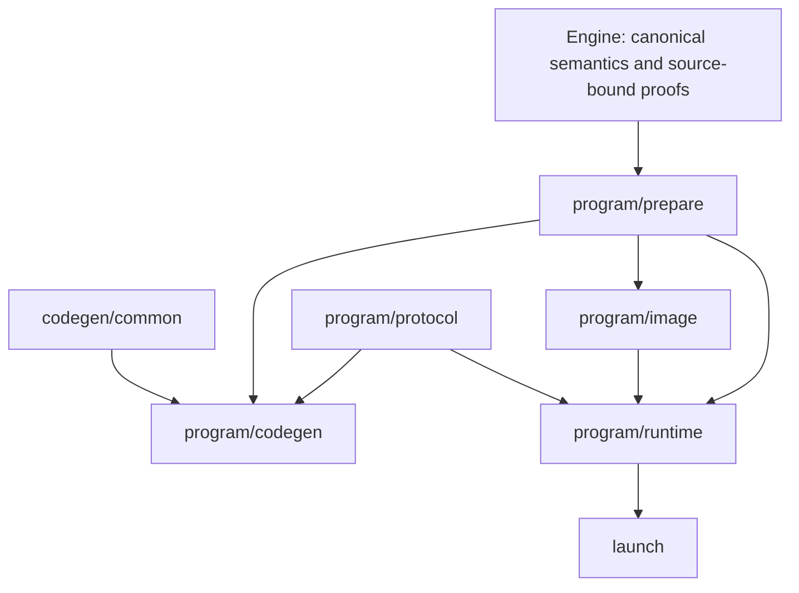

# Native compiler consolidation

This is the maintained ownership contract for the consolidation
above PR #934. The public source/bytecode → canonical `ProgramArtifact` → checked
native plan → shared JIT/Object definition path remains authoritative. Supported
scalar, match, iteration, managed, hosted, benchmark-policy and source-native
entry points remain supported. No stack is merged by this work.

## Fixed baseline and evidence

The implementation and exact before/after evidence are maintained in
[mech-lang/benchmarks](https://github.com/mech-lang/benchmarks/pull/2), under
`experiments/mech/native-owner-aot-v1/`. The architecture's repaired #934
baseline is `ddf8cbc3b17a644ea6292ee3bf0c4a9c63af4514`; #935's prepared
architecture head is `a3e805aae775a8aa6bf181714c8cbe7c9e6619e9`.
The additional cleanup follows #935. Historical receipts never qualify a new
compiler or executable. Preserve the exact retained winning Mech/Rust controls,
source, input, output/work and secured complete-process boundary. Prospective
plans and acceptance gates must be committed before primary observations.
The unchanged before-cleanup executable remains retained for comparison.

## Dependency and authority graph

Engine proofs have private constructors and no public Deserialize. Read-only
same-plan facts share graph primitives, not consumer eligibility. Runtime image
restoration is an independent checking boundary; neither a serialized proof,
codegen report nor numeric footprint grants execution authority. Runtime-only
code never imports Cranelift, JIT, Object emission or parsing. Common emission
never depends on a packed-map strategy. Session orchestration never probes maps
or performs compiler analysis. Representation modules never own global dispatch.

## Preparation and work

One owned `PreparedNativeProgram` holds `ProgramMetadata` and complete
text-line frontiers. Its private fields are exposed by typed shared accessors.
CodePlan keeps distinct scalar and prepared-program variants. Emission borrows
preparation; descriptor finalization hashes complete inventories, then moves
metadata without cloning the plan. Source-backed reconstruction uses the same
preparer; build-owned restoration does not rerun it or bind calls twice.

The ordered recipe is: revision/current-visit validation; aggregates;
parallel/retirement; completion allowance; borrowed strings; string-map inventory
and selected joins; line matrices; body/charged visits and join funding; complete
frontiers and prefix; borrowed/prefix work; map-owner facts/work; closed tails/work;
map admission; actual selected-call binding/query stages; window inventory;
frame prefix/one owner relocation; frozen maps; types/constants/ownership bounds.
Compile host/target and bounded counts are checked before substantial preparation.

Three quantities remain distinct:

- Analysis visits have zero completion **base**; selected joins may add 64 there.
- Charged visits have completion base `64 * outputs + 8 * iterations + 256`,
  plus existing ordered source-bound supplements.
- Emitted instruction bounds preserve primitive precedence, helper operands and
  borrowed/tail/prefix additions; they are not charged runtime work.

Checked addition and validation order remain explicit. Completion sites never
enter map admission. Frame assignment retains scalar + iteration + aggregate +
borrowed + closed words, then relocates owner words once. Unselected frontiers
remain in the identity transcript.

## Runtime and protocols

One ExecutionState owns control, arena, collections/maps, retained calls,
caches, stats and cursors. ControlState is shared mechanically with iteration
execution. Invocation borrows state and disjoint transport lanes synchronously.
`Prepared.state` remains optional: take before admission, invoke, validate and
clear loans, restore the same state only on success. Every error after take is
terminal. No restore-on-error guard, state clone, lock, RefCell or guest dispatch
is introduced. Drop map/line/collection owners before arena, and backing before
the reservations paying for it. Mutable frame-lane references never span native
execution. Packed frames retain stable Box addresses and refreshed export slots.

Map Slot keeps its three Option-backed fields and existing charged envelope.
Named transitions represent Vacant, Retained, Closed, FrozenPending and
FrozenPublished; terminal cleanup-only partial storage never resumes. Closed map
modes 0/2/3 remain distinct from scalar tail modes 1/4. `has_retained_binding`
preserves the former `active` predicate; occupied and active-table counts differ.

Global helper tags and closed-owner operations have separate typed domains.
Owner IDs 0–14, global IDs 0/1/2/output range and MAX-1 through MAX-25 retain
numbers, ignored lanes, debit/validation order and error origins. MAX-15 is live
StructuralObservation. Naming tags grants no new precise memory-effect proof.

Descriptor serialization remains explicitly flat. Preserve image format
`mech.build-owned-native-descriptor` v1, typed IR 94, work 69, program ABI 33,
192-byte identity, offsets 112/120 for same-Object footprint and all frame
offsets/symbols. `constant_admission_bytes` remains a recomputed nonserialized
cache. Proof DTOs belong to image/wire, with independent frozen-map and
selected-join association checks. No version bumps or resource repricing.

## Cleanup and history

The original 197-path move manifest and full implementation/deletion receipts
are preserved with their hashes in the primary benchmarks study
`post-native-architecture-cleanup-v1/audit/`. They record historical moves;
they are not a second authority over the current Rust module tree.
The [post-architecture cleanup ledger](native-post-architecture-cleanup.md)
records the current deletion audit and verification requirements.

## Feature matrix and verification

| Feature | Permitted responsibility |
| --- | --- |
| no default features | no canonical compiler/runtime dependencies |
| canonical-native-runtime | scalar/match/iteration ABI, linked runtime and compiled family launch |
| canonical-native-program-runtime | preparation, image restoration, program state/protocol; no compiler/parser |
| canonical-native-program-host-runtime | hosted resources/provider launch; no resident routing/compiler/parser |
| canonical-native / canonical-native-program / program-host | compiler/JIT/Object and corresponding build/generation APIs |
| optional benchmark policy / native-source | retained separate adapters, never public canonical fallback |

Use pinned nightly-2026-03-03, locked offline dependencies after fetch. Baseline
and final inventories enumerate ignored cases, and execution reports actual
nonempty selections. Retain native unit, native_text_line, workers and catalog
scopes; six scalar-family integration suites and managed Program; source map
contracts; four independent minimal feature checks and dependency inspection.
Reusable fixtures remain small; contract tests stay beside their owner.

Public CLI and hosted qualifications use the existing bounded CI scripts and
saved/pinned harnesses in ci-native-plan.yml. Execute all five CLI unit cases,
all three ignored public-process cases and the ignored original/decoded hosted
process case with their negative controls, receipts and completion checker.
Compare representative emitted guest instruction bodies and resource/identity
outputs with I, not whole host executable bytes. Final changed-input oracle runs
the same exact F and I executables on all seven retained changed inputs.
