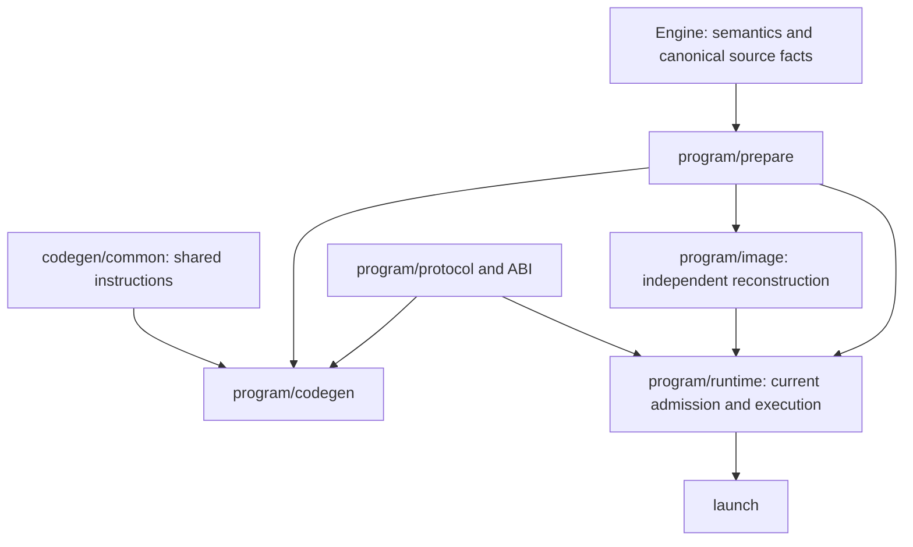

# Native compiler architecture

The maintained path is source/bytecode → canonical `ProgramArtifact` → checked native plan → shared JIT/Object emission → current execution. Engine owns language semantics. Native preparation selects representations; runtime image restoration independently reconstructs their source facts. The current retained versions are **IR175 / work107 / private ABI39 / bytecode14**. [Current milestone and qualification](native-compression-status.md).

## Responsibilities and authority

| Owner | Responsibility | Authority it does not grant |
|---|---|---|
| Engine | Canonical semantics, selected factories, definitions, uses and source-bound proofs | Host representation selection or current exclusive ownership |
| `program/prepare` | Eligibility, representation inventories, physical consumers, prices and checked boundaries | Reusable current account/alias permission |
| Shared codegen | Scalar instructions and common addressing; JIT/Object consume the same checked preparation | New operation semantics or permission to skip errors |
| `program/runtime` | Current values, accounts, loans, funding, settlement, publication and cleanup | Trust in serialized eligibility or old invocation authority |
| `program/image` | Format/identity checks and independent source reconstruction | Authentication of arbitrary machine code |
| Protocol/ABI | Shared tags, lanes, offsets and progress transitions | A second semantic interpreter |

Representation modules do not own global dispatch. Session orchestration does not perform compiler analysis. Runtime-only features do not import parsing, Cranelift, JIT or Object emission. Engine proof constructors remain private; serialized proof bytes are not source authority.

## Checked preparation

One `PreparedNativeProgram` owns metadata and complete frontiers. Emission borrows it; finalization moves the checked inventories into the descriptor. Source-backed reconstruction uses the maintained preparer; build-owned restoration independently rebuilds the required facts without trusting serialized recipes.

Preparation validates revision, selected current visits and counts before substantial analysis. It derives aggregates, frontiers, visits/prices, owner layouts, closed numeric regions, map admission, selected calls, windows, types and constant ownership in their required order. Frame assignment and owner relocation happen once. Completion sites remain outside ordinary scalar admission groups.

Analysis visits, charged source work and emitted-instruction bounds are distinct quantities. Checked additions retain failure order. Completion, helper, borrowed, parent/child and retirement supplements remain explicit. No hardware instruction count is inferred from conservative work accounting.

## Native numeric selection and emission

Numeric codegen may combine a complete confined little-endian byte expression into one native word load. It derives the expression from canonical definitions/read roles and the existing selected U8-read recipe; it introduces no serialized permission or second numeric representation. Only same-iteration single-entry Jump chains without escaping intermediates, mutations, assertions, funding boundaries or cold/interior entries qualify. Current vector geometry and an overflow-safe initialized-length guard authorize the unaligned load at the lexical first action. Refusal executes every original source action, preserving error order, work and recovery. Image reconstruction independently preserves the same source facts; emission identity distinguishes the changed code. The ordinary read path remains necessary for unsupported expressions and refused current windows.

Numeric regions require source definitions, versions, scopes, confined uses and supported operations. Nested synchronous Tail children use current-account fuel; unsupported or non-Tail work exits through the exact ordinary continuation. Membership in a native region and membership in the current prepaid traversal are separate facts.

Numeric codegen may remove a complementary Boolean case test only after proving its exact current comparison → empty case → empty complementary case chain. Engine's polarity facts describe the branches; codegen additionally requires a unique comparison producing a 0/1 word, sole predecessors, unchanged predicate, same iteration and selected source membership. Entry, exit and debit markers block the proof. Unknown Boolean inputs, merged definitions and other unsupported chains keep their checks. The reached source site and its charges remain; only its redundant test becomes the existing success edge through the shared terminator emitter. This introduces no runtime state or serialized authority. Codegen derives the map afresh from the checked plan. Linked restoration does not restore this map; it retains the existing same-build/Object provenance and IR175 contract, with reconstruction and runtime checks unchanged.

Existing acyclic parent pieces also cover eligible ordinary descendants of a selected numeric phase. Same-root whole phases remain unsplit. Descendant pieces retain the full ordinary source price and carry no prepaid-region recipe; current overlap with any paid source member declines to ordinary execution. The existing numeric/frame proof, admission, scalar emitter and child frontiers remain the only execution machinery for these pieces. A fixed-time necessary-only guard excludes an iteration newer than the current deepest paid iteration: checked parent IDs decrease, and every piece member has its parent iteration. All remaining cases retain the exact source-inventory and root-clipped ancestry checks. Build-owned images preserve this order through the unchanged checked-plan/Object provenance contract; the full Engine ordering validator is not rerun at restoration.

The shared word emitter owns scalar arithmetic. Unsigned full-width addition uses the wrapping result plus `sum>=left` as its checked guard; subtraction checks `left>=right`. Signed/narrow arithmetic and multiplication retain their maintained rules. Original failure origin, funding and publication semantics remain.

General numeric matrix addressing preserves column-major selection over row-major storage: one quotient gives the column; subtraction gives the row. Schema-proved unit dimensions retain their division-free route. Generic schemas also use the physical ordinal directly when the current admitted view has one row or one column; rectangular views keep the same general formula. Caller bounds precede this calculation, establishing nonzero rows on a selected load/store and the safe remainder. The current geometry test grants no new permission or static fact. Reads, writes and segments use the same helper; image reconstruction preserves the same independently derived facts, with emission identity distinguishing changed code.

Freshness analysis removes historical SSA contents only for lexical locals wholly defined/read in the selected traversal and dead at entry. Captures, carriers, constants, escaping values and partially selected definitions retain their state. Internal temporaries are defined by their source actions.

Exit analysis preserves actual physical consumers: current continuation values, carrier fields, arrays and initialized lengths, readiness/fuel, loop counters and settlement state. Ordinary cold exits retain live aliases and exact active ancestors. Bounds and terminal failures keep the operands/origins and cleanup they need. Narrowing these consumers does not compact the full admitted word bank.

Repeated definitions and shared SSA homes use the same memory region. Private fuel cannot be assigned an alias class disjoint from its own stores. Initialized input lanes, native temporary definitions and exported words each follow their selected representation.

## Collections and buffers

Pointwise collection lowering requires a total scalar body, definite assignment, dominating captures and confined result uses. The ordinary initializer establishes an exact-length loan; native execution fills the uninitialized sink. Initialized length becomes observable only after successful completion. Failed execution exposes no partial result and cleanup drops only initialized elements.

Uniform range construction remains distinct: it requires `U64Range`, while pointwise lowering requires `Value`. Ordinary collection execution also remains necessary for unsupported, fallible or tight-resource cases. These are different proved domains, not duplicate engines.

The selected little-endian byte append shares the existing numeric-array path. Engine recognizes the exact U8 matrix / U64 word / U8 count factory. Preparation forwards the current array and invalidates old versions. Zero count keeps the existing owner; invalid count settles and executes the original selected rejection at its lexical position.

Positive first change uses the maintained checked Engine factory and existing private owner. Subsequent funded native visits store a little-endian word into eight proved spare U8 cells, then advance logical length by the actual count. The conservative traversal bound includes every append site. Failure to fund/capacity-prove the region retains ordinary execution. The short-buffer fallback timing finding remains explicit in current status.

Actual exclusivity is always checked by Core. Static last-use facts supply candidates, not permission; live aliases preserve their required copy behavior. Private ownership is not an excuse to skip finite admission, shape/value validation or atomic publication.

## Current execution and recovery

`ExecutionState` owns control, arena, collections/maps, retained calls, caches, statistics and cursors. An invocation borrows it and transport lanes synchronously. No mutable frame-lane reference spans native execution. Boxed frame storage keeps stable addresses and export slots are refreshed.

Current owner/schema keys, account membership, geometry, capacity, aliases and funding remain dynamic. Entry previews can decline to the ordinary path. First change, exact child funding, cold export and final publication retain their original charge/error order. Paid native prefixes do not authorize a later invocation.

A native cold handoff stages the exact active tracked-child marker independently of paid depth. Preparation derives each native root's outer context privately from validated ancestry; runtime checks that context and walks only the already bounded active-to-root chain before restoring control. The marker grants neither ownership nor fuel. Parents whose child completion is a native cold predecessor remain ordinary, preserving pending-return consumption without a second completion protocol. Worker and ordinary scalar paths retain their existing behavior.

Finite failure preserves previously published outputs and input aliases; abort cleans private state and later independent evaluation can retry. Consumed execution-state transitions remain terminal where specified. Owners drop before the arena; backing storage drops before the reservation funding it. No successful-return guard restores a failed consumed state.

Owner protocol tags and global helper tags remain separate typed domains. Preparation, emission and runtime share their maintained ABI definitions. Frame/map transitions retain their current modes and ignored-lane/error-order contracts; naming a tag does not prove a stronger memory effect.

## Image reconstruction

The flat build-owned image contains the canonical plan and selected inventories. Restoration validates revisions, type slots, source constants, calls, frames and layouts. It independently rederives and compares closed numeric recipes, scalar aggregate lanes, pointwise collections, map admission and selected owner associations, reconstructing the frontiers/prices needed for those checks. Parent-piece selection and native-root continuation contexts use the same pure derivation from that validated plan; the private context bank is not serialized authority. Several other layouts and visits remain serialized under the same-build/Object contract. Malformed or older revisions are rejected strictly.

The unsafe linked loader requires the same checked build/Object identity and code provenance. Descriptor reconstruction does not authenticate arbitrary code. Codegen reports, footprint counts and serialized eligibility do not grant a raw buffer view. Current runtime admission still runs after successful image validation.

Within one derivation, freshness and header-boundary construction share their exact full header-liveness result: immutable plan, root, facts and empty predicate context are identical. The owned set stays within that call; exit-specific queries and independent image reconstruction remain. This removes duplicate computation without a persistent cache or new authority. Residual reachability/liveness work leaves image admission near 34.6 s, a known usability cost outside compression timing. Further reuse must preserve exact predicate/root/cut contexts and validation.

## Feature and verification boundaries

| Feature family | Permitted responsibility |
|---|---|
| No default features | No canonical compiler/runtime dependencies |
| `canonical-native-runtime` | Scalar/match/iteration ABI, linked runtime and family launch |
| `canonical-native-program-runtime` | Preparation, image restoration and program state/protocol; no parser/compiler |
| `canonical-native-program-host-runtime` | Hosted provider launch without resident routing/parser/compiler |
| Canonical compiler / program / host features | Corresponding checked preparation, JIT/Object and generation APIs |
| Optional benchmark/source-native adapters | Separate opt-in paths, never canonical fallback |

Warnings remain errors. Architecture/catalog/unsafe/memory boundaries and nonzero CI inventories remain checked. Qualification distinguishes original/decoded/restored and linked execution, finite errors, selected paths, unused results, aliases, publication, cleanup and retry. Current exact commands, counts and exclusions belong to the evidence index, not another copied history here.

## Extension and integration rules

Each change must name its owner, authorizing facts, independent reconstruction, current runtime checks and any superseded machinery. Reuse the existing operation implementation and shared emitter. Keep semantically required ordinary fallbacks until their domains are covered and proved.

Keep coupled proof, layout, emitter, runtime and identity changes in the same integration increment. Test/CI repairs can remain independently reviewable. Any newly discovered compiler gap needs its real program operation, minimal witness and acceptance test before expanding scope.

Retained coverage, liveness, address/arithmetic and byte-writer capabilities are complete within their documented domains. Full word-bank compaction, direct stores after backing is private, bounded-child trip proofs in dynamically funded phases, source pricing rewrites and further allocation/instruction work are deferred. No safely deletable duplicate or temporary production instrumentation was found in the R130→R140 closure review.

Historical decisions, rejected experiments, source pins and old document snapshots are preserved in the [existing experiment archive](../../benchmarks/mech-deflate/experiments.json). They are evidence, not a second authority over the current module tree.
