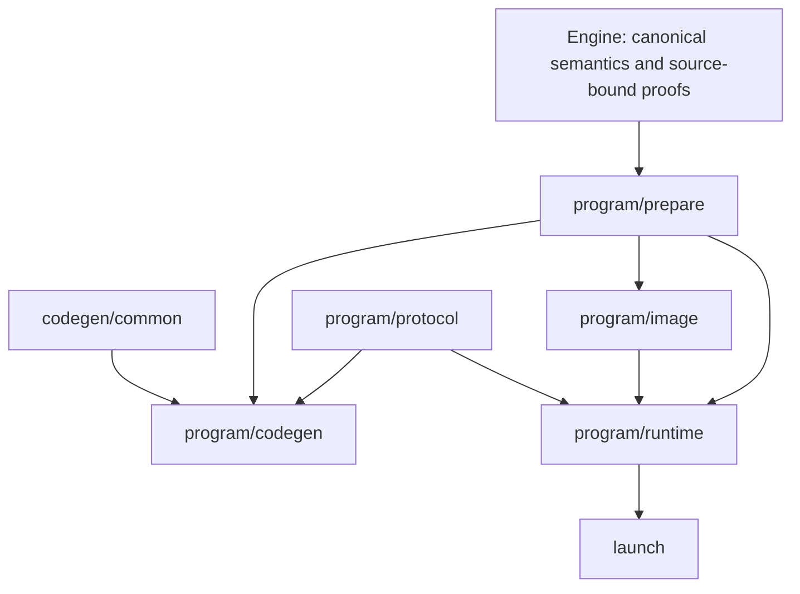

# Native compiler consolidation

This is the maintained ownership contract for the consolidation
above PR #934. The public source/bytecode → canonical `ProgramArtifact` → checked
native plan → shared JIT/Object definition path remains authoritative. Supported
scalar, match, iteration, managed, hosted, benchmark-policy and source-native
entry points remain supported. No stack is merged by this work.

## Fixed baseline and evidence

The implementation and exact before/after evidence are maintained in
[mech-lang/benchmarks](https://github.com/mech-lang/benchmarks/pull/2), under
`experiments/mech/native-owner-aot-v1/`. The architecture's repaired #934
baseline is `ddf8cbc3b17a644ea6292ee3bf0c4a9c63af4514`; #935's prepared
architecture head is `a3e805aae775a8aa6bf181714c8cbe7c9e6619e9`.
The additional cleanup follows #935. Historical receipts never qualify a new
compiler or executable. Preserve the exact retained winning Mech/Rust controls,
source, input, output/work and secured complete-process boundary. Prospective
plans and acceptance gates must be committed before primary observations.
The unchanged before-cleanup executable remains retained for comparison.

## Dependency and authority graph

Engine proofs have private constructors and no public Deserialize. Read-only
same-plan facts share graph primitives, not consumer eligibility. Runtime image
restoration is an independent checking boundary; neither a serialized proof,
codegen report nor numeric footprint grants execution authority. Runtime-only
code never imports Cranelift, JIT, Object emission or parsing. Common emission
never depends on a packed-map strategy. Session orchestration never probes maps
or performs compiler analysis. Representation modules never own global dispatch.

## Preparation and work

One owned `PreparedNativeProgram` holds `ProgramMetadata` and complete
text-line frontiers. Its private fields are exposed by typed shared accessors.
CodePlan keeps distinct scalar and prepared-program variants. Emission borrows
preparation; descriptor finalization hashes complete inventories, then moves
metadata without cloning the plan. Source-backed reconstruction uses the same
preparer; build-owned restoration does not rerun it or bind calls twice.

The ordered recipe is: revision/current-visit validation; aggregates;
parallel/retirement; completion allowance; borrowed strings; string-map inventory
and selected joins; line matrices; body/charged visits and join funding; complete
frontiers and prefix; borrowed/prefix work; map-owner facts/work; closed tails/work;
map admission; actual selected-call binding/query stages; window inventory;
frame prefix/one owner relocation; frozen maps; types/constants/ownership bounds.
Compile host/target and bounded counts are checked before substantial preparation.

Three quantities remain distinct:

- Analysis visits have zero completion **base**; selected joins may add 64 there.
- Charged visits have completion base `64 * outputs + 8 * iterations + 256`,
  plus existing ordered source-bound supplements.
- Emitted instruction bounds preserve primitive precedence, helper operands and
  borrowed/tail/prefix additions; they are not charged runtime work.

Checked addition and validation order remain explicit. Completion sites never
enter map admission. Frame assignment retains scalar + iteration + aggregate +
borrowed + closed words, then relocates owner words once. Unselected frontiers
remain in the identity transcript.

## Shared general numeric address quotient

R137 preserves canonical column-major selection over row-major backing while
emitting one exact quotient for each general numeric address. The shared native
read/write/segment helper computes column=ordinal/rows, row=ordinal-column*rows,
then row*columns+column. Current view admission and prior valid selection imply
nonzero rows and quotient*rows<=ordinal; no new source error, arithmetic wrapping
rule or permission is introduced. Schema-proved unit dimensions retain their
existing division-free emission. All unsigned widths use the same helper.

An independent actual JIT address oracle covers rectangles, vector orientations
and large integers; ARM64 generated-code tests require exactly one UDIV for
dynamic geometry. Original/decoded component tests retain changing shapes,
invalid/empty selections, aliases, finite errors, publication and recovery.
IR166 commits the changed lowering and rejects165; work107/private ABI39/MBC14
remain. Image reconstruction and full admitted/physical exit inventories stay.

## Fresh temporary state at lexical numeric roots

R135 derives a current-traversal freshness list from canonical value scopes,
sealed definitions, all read roles and root-header liveness. Only immutable
scalar, private-frame scalar or scalar-aggregate values owned wholly by selected
loops can qualify. Captures, carriers, constants, values read before definition,
external reads and partially selected definitions retain their existing state.
Image restoration independently reconstructs the complete list; IR164 commits
this lowering contract with work107/private ABI39/bytecode14 unchanged.

At each selected root header, codegen assigns only these private SSA lanes a
fresh constant. This removes dependencies on unobservable previous-visit
temporaries. It neither initializes source buffers nor replaces a source
operation. Current array/view state, ownership, finite charges, error origins,
boundary synchronization and publication remain authoritative. Shared scalar
instructions and SSA emission remain the only scalar vocabulary. This is not
physical word-bank compaction or complete exit-family narrowing.

## Exact physical numeric boundary consumers

R136 retains the existing canonical graph, lexical latch/finish cuts and
current-predicate facts, then derives the ordinary continuation's live values
for each cold edge and the root header/success boundaries. Shared scalar,
private-frame and scalar-aggregate layouts expand those values into physical
words. Existing loan, view, fuel and settlement consumers are mandatory in
addition to source liveness. The shared terminal-error arm keeps abort consumers
and cannot resume source execution. Bounds and first-change bridges retain
their existing behavior. Mode6 restores the exact source edge's active frames.

Only these consumers require a physical snapshot. Eliminating synthetic uses
of historical temporaries lets the shared SSA backend shorten their lifetimes;
it changes neither source operations nor the admitted word capacity. Original
charges, error origins, ownership, aliases, atomic publication and recovery stay
on the maintained paths. The earlier rejected terminal-error-only experiment
does not establish this all-family result.

Liveness uses predecessor-driven delta propagation with the same least fixed
point. Normal-exit queries project onto a canonical candidate superset derived
from selected reads, definitions, terminators and all frame recipes. Codegen
requires its expanded candidates to cover every registered source word before
using that projection; settlement consumers remain independent. Path-reachability
and projection oracles, cyclic complexity controls, original/decoded/restored
programs and independent image reconstruction check this contract. Missing or
forged proof lists are rejected. Native IR165 commits the change; work107,
private ABI39 and bytecode14 remain. Independent image reconstruction still has
a measurable startup cost outside the compression timer.

## Nested numeric regions with exact non-Tail exits

R130 composes the existing current-funded Tail schedule with exact cold
non-Tail boundaries. Static presence of a Collection no longer disqualifies
the supported Tail descendants. Preparation cuts flow before the original
Collection builder/initializer and retains the same checked operations, word
homes and private owners on all supported paths. Complete/static/scalar-cold
selection remains preferred; the existing single-root interval remains a fallback.
Appending children and unsupported managed escapes still decline.

Register the full child input-binding tree before checking recursive returns.
A child's current return can depend on a deeper child's carrier. An incomplete
binding inventory is not evidence of a changed root. The independent version
analysis still proves each reached read, recursive edge and return current,
including caller bindings required by a cold continuation.

An unsupported edge inside a native child exports only its exact current live
values, freezes private buffers and settles the same loan before ordinary code.
Restore the source edge's active Tail and its actual ancestor chain. Unlike an
unpaid child initializer/header, that active Tail's current traversal was paid;
only it and its paid ancestors keep source credit. Latches/returns consume it.
The ordinary Collection initializes its own hidden state after the exit. Image
restoration rederives these edges, bindings, homes, counters and prices.

Initial entry transports only carrier scalars, current views/capacities, private
flags and counters. Internal scalar frame lanes are assigned by the selected
source. The real collector copies 102 entry words from an admitted 1,080-word
bank. Keep the full capacity, original finite charges and first-change transport;
omitting irrelevant initial copies does not grant additional account authority.
IR160 commits this lowering contract; work107/private ABI38/bytecode14 remain.
The measured gains and increased generated text/stack are recorded separately in
[the current status](native-compression-status.md#r130-retain-collector-state-through-nested-native-loops).

## Physical cleanup follows the selected representation

R129 retains the original logical retirement inventory and reached flags for
native parent pieces. A separately derived physical recipe replaces only
unmaterialized private frames/projections with their original ordered per-value
charges. Current input owners keep their existing retirement. This is neither
another batch nor a new instruction language; it specializes existing cleanup.

All native-word-only definitions are already absent from ordinary arena retirement
tables. For eligible parent pieces, existing entry checks prove private field
lanes empty and aliases have no canonical slot. Only omitted frame retirements
need an additional current canonical-slot emptiness check. No owner is created
during native execution; actual escapes materialize after ordered cleanup. Groups
without omitted effects stay on the original loop. Finite funding, price/order,
failed admission, unchanged publication and retry retain their existing paths.

The physical cache is never trusted from the image: restoration rederives it
from the canonical plan and selected implementations. IR159 preserves strict
rejection of prior experiment images. Work policy107 and private ABI38 stay
unchanged. The generated compressor text is byte-identical to the R128 control.

## Current-account child visits and current buffer results

R128 keeps the existing numeric plan and shared scalar/SSA emission while
composing fixed-size mutable Tail children. Children return bindings to current
phase owners and native scalar fields. Local induction proves their recursive
and terminal versions. A caller must additionally prove every outer binding
needed by a child cold continuation current at entry; later writes invalidate
those bindings. No root-identity shortcut grants permission to reuse older data.

Existing static/scalar-cold schedules remain preferred. When a whole-child trip
bound is unavailable, generated initializer and recursive-header checks fund one
visit against the same current compute/comparison account. The first header uses
the initializer's debit exactly once. Counters report actual reached visits,
including post-first-change execution; a later child cannot rely on pre-mutation
credit. Successful internal edges have no runtime callback.

A failed check uses an independently reconstructed initializer/header exit.
Export current scalar/frame/buffer state, freeze private cells, settle the same
loan, then restore the exact lexical Tail chain. Only already-paid current
ancestors retain source-price credit; the target child visit is unpaid. An
ordinary latch/finish consumes that ancestor's credit, preventing replay or
renewal. Cold exports and all fallible admission precede publication. Existing
bounds/arithmetic/assertion errors keep their source positions. Child appends,
non-Tail descendants, older observable versions and unproved guards retain the
ordinary path. IR157 binds these homes, scopes and prices to image identity.

## Complete synchronous numeric phases

R119 extends numeric lowering over the existing canonical CFG. The common
`numeric_plan` vocabulary supplies operations, buffer bindings, scalar homes and
result recipes to leaf loops, parent segments and complete phases. Existing
scalar emission and `SsaWords` remain shared. There is no second IR, guest
dispatcher, unrolling or function-name specialization.

Preparation first derives a root tail and eligible synchronous descendants,
then selects a nonoverlapping execution owner before parent composition. A
selected phase owns its source sites; its children do not retain separate
entry/exit protocols or parent segments. Uncovered cases retain the existing
leaf/segment and ordinary paths. These adapters still cover effects beyond the
initial phase contract and are not yet eligible for blanket deletion.

The initial contract permits unsigned packed views, one root append owner,
scalar/fixed-aggregate child results and scalar enum transitions. Child effects
are read-only during each invocation. Definitions and branches are resolved in
the current traversal; the acyclic order cuts all declared loop backedges and
rejects remaining cycles or unsupported edges. Mutations must follow all child
calls in that outer traversal so a first-change bridge cannot spend fuel needed
by a later child. Collections, activations, escaping managed child results,
unknown progress/effects, workers and active maintained scopes decline.

Array provenance identifies a binding; current-version validation separately
proves every child read, forwarded carrier and result uses the current functional
version. The parent's logical length and append contents remain current on the
next child visit. Core establishes exclusive storage at first effective change
or preserves a live older alias through its existing copy path. Parent/child
scalars and traversal counters have distinct logical homes; only separate phases
share the outer scratch bank. Generated child entry, latch, return and scalar
results are direct control flow inside one numeric loan and private-owner state.

At the original outer header, checked sufficient envelopes admit one complete
traversal and its children. Overflow or insufficient credit/capacity settles the
completed native prefix and resumes the ordinary header before new source work.
The envelope is not the debit: generated counters and local fuel charge each
actually reached traversal at its policy price. Settlement independently
reconciles the fuel difference with the sum of those traversal prices. First
change spills counters/scalars, settles, invokes the original operation and
resumes the already funded traversal; it does not renew fuel or replay append.
Failure cleans up unpublished state and retains original source origins/order.
Publication remains at real exits. Cold growth within an active nested child is
outside this first contract.

R121 also applies the existing ordinary source-site canonical alias-retirement
proof at a nested phase's first effective mutation. The bridge funds its exact
candidate checks after settling the current loan, takes the carrier pin, and
retires only candidates with the same current frozen identity. It then uses the
original checked replacement/append factory and Core's exclusivity decision.
Live frame fields and external aliases remain owners; no arena-wide scan grants
consumption. An absent last-use candidate retains the copy path. Existing
child-free leaf handoffs and their qualified prices remain unchanged.

R122 separates canonical call owners from raw numeric argument words. Preparation
and independent image loading derive the owner span from source call arity,
parent-piece source pins and fixed window/string-map support. The span is not a
serialized permission. A checked `CallInputs` view exposes only that prefix;
its unexposed tail stays empty. The original full backing, initialization,
admission floor and transport/header charges remain. Numeric words retain their
separate existing typed storage. A larger numeric phase therefore cannot expand
every canonical stale-owner scan merely by needing more scalar scratch words.

R123 broadens that same phase proof to positive constant progress and checked
constant offsets in loop guards. Checked `counter + offset <= bound` is only an
upper-bound fact on its successful source edge. Every continuing update must
advance by a positive constant; conservative admission arithmetic must fit before
wrapping progress is accepted. Equality-target proofs retain the exact unit
stride rule. Wrapping guard offsets, zero/dynamic/overflowing strides and unknown
progress still decline. Source checks, errors and reached traversal prices remain.
This is complete-subtree selection; R124 adds the bounded fallback below.

R124 first attempts that complete proof, then can summarize direct synchronous
Tail children with scalar results as explicit cold edges. A successful native
parent never follows a summary edge: it freezes current private buffers, exports
only the exact live current frames/aliases, settles the loan, and jumps to the
original child initializer. The child and the remainder of that source traversal
execute ordinarily. The parent re-enters at its next original header, after its
original latch. Earlier stores are neither replayed nor rolled back.

The current parent traversal is prepaid once. Its ordinary remaining source
visits retain control/progress checks while consuming that prepared credit;
actual child and selected-library work still use the same authoritative account.
Credit ends at the parent latch/finish, and the next native loan uses the current
post-write/post-child remainder. A second cold parent cannot nest within pending
parent credit. The persistent resume flag belongs to the individual region's
state, separately from scratch shared by sequential numeric phases. If entry
declines, ordinary execution proceeds without a repeated resume attempt.

Cold-edge liveness and current versions are independently reconstructed on image
restoration. Immutable current-traversal branch facts can prune impossible
liveness edges, but never change emitted source branches. Unknown or older
managed versions still decline. A fallback refusal preserves the original
complete-proof diagnostic. Non-Tail children, managed child results and mutable
included children remain outside this bounded contract. Huffman counting is
qualified with an actually taken clamp after a native write, including failure,
unchanged publication, aliases, finite accounting and retry.

Build-owned image validation independently reconstructs phase membership,
bindings/current versions, homes, bounds, debit identities and result recipes
from the validated program. Serialized metadata grants no raw-view authority.
The emitted fixed boundary is bounded from the phase's word inventory, then
checked against the actual emitted instruction count. The current versions
are typed IR155 and work107, with ABI38 and bytecode14 unchanged; the version
numbers below describe the historical consolidation baseline.

Actual numeric intervals cut the source CFG at the unsupported synchronous Tail,
collection or range boundary; they do not invent a managed child result. Native
membership and prepaid root membership are separate. A cold exit exports live
current frames/aliases before retiring a dead root carrier with the existing
charged recipe. Core still checks actual exclusivity, so a live older alias keeps
its copy semantics. Original and restored images derive the same inventory.

The ordinary cold route retains the existing parent-piece lowering. Prepared
source-price coverage requires one exact root, all segment members and a sufficient
root traversal debit. Runtime credit requires that same current continuation;
entry, synchronization, per-piece overhead and reached retirement keep their own
charges. No account or earlier debit is refunded. Acyclic prefixes and contradictory
immutable backedge conditions retain their existing parent pieces. Shared SSA
initialization, spill, reload and boundary accesses use the same per-home memory
region; private fuel cannot be a disjoint alias class from its own stores.

## Runtime and protocols

One ExecutionState owns control, arena, collections/maps, retained calls,
caches, stats and cursors. ControlState is shared mechanically with iteration
execution. Invocation borrows state and disjoint transport lanes synchronously.
`Prepared.state` remains optional: take before admission, invoke, validate and
clear loans, restore the same state only on success. Every error after take is
terminal. No restore-on-error guard, state clone, lock, RefCell or guest dispatch
is introduced. Drop map/line/collection owners before arena, and backing before
the reservations paying for it. Mutable frame-lane references never span native
execution. Packed frames retain stable Box addresses and refreshed export slots.

Map Slot keeps its three Option-backed fields and existing charged envelope.
Named transitions represent Vacant, Retained, Closed, FrozenPending and
FrozenPublished; terminal cleanup-only partial storage never resumes. Closed map
modes 0/2/3 remain distinct from scalar tail modes 1/4. `has_retained_binding`
preserves the former `active` predicate; occupied and active-table counts differ.

Global helper tags and closed-owner operations have separate typed domains.
Owner IDs 0–14, global IDs 0/1/2/output range and MAX-1 through MAX-25 retain
numbers, ignored lanes, debit/validation order and error origins. MAX-15 is live
StructuralObservation. Naming tags grants no new precise memory-effect proof.

Descriptor serialization remains explicitly flat. Preserve image format
`mech.build-owned-native-descriptor` v1, typed IR 94, work 69, program ABI 33,
192-byte identity, offsets 112/120 for same-Object footprint and all frame
offsets/symbols. `constant_admission_bytes` remains a recomputed nonserialized
cache. Proof DTOs belong to image/wire, with independent frozen-map and
selected-join association checks. No version bumps or resource repricing.

## Cleanup and history

The original 197-path move manifest and full implementation/deletion receipts
are preserved with their hashes in the primary benchmarks study
`post-native-architecture-cleanup-v1/audit/`. They record historical moves;
they are not a second authority over the current Rust module tree.
The [post-architecture cleanup ledger](native-post-architecture-cleanup.md)
records the current deletion audit and verification requirements.

## Feature matrix and verification

| Feature | Permitted responsibility |
| --- | --- |
| no default features | no canonical compiler/runtime dependencies |
| canonical-native-runtime | scalar/match/iteration ABI, linked runtime and compiled family launch |
| canonical-native-program-runtime | preparation, image restoration, program state/protocol; no compiler/parser |
| canonical-native-program-host-runtime | hosted resources/provider launch; no resident routing/compiler/parser |
| canonical-native / canonical-native-program / program-host | compiler/JIT/Object and corresponding build/generation APIs |
| optional benchmark policy / native-source | retained separate adapters, never public canonical fallback |

Use pinned nightly-2026-03-03, locked offline dependencies after fetch. Baseline
and final inventories enumerate ignored cases, and execution reports actual
nonempty selections. Retain native unit, native_text_line, workers and catalog
scopes; six scalar-family integration suites and managed Program; source map
contracts; four independent minimal feature checks and dependency inspection.
Reusable fixtures remain small; contract tests stay beside their owner.

Public CLI and hosted qualifications use the existing bounded CI scripts and
saved/pinned harnesses in ci-native-plan.yml. Execute all five CLI unit cases,
all three ignored public-process cases and the ignored original/decoded hosted
process case with their negative controls, receipts and completion checker.
Compare representative emitted guest instruction bodies and resource/identity
outputs with I, not whole host executable bytes. Final changed-input oracle runs
the same exact F and I executables on all seven retained changed inputs.
