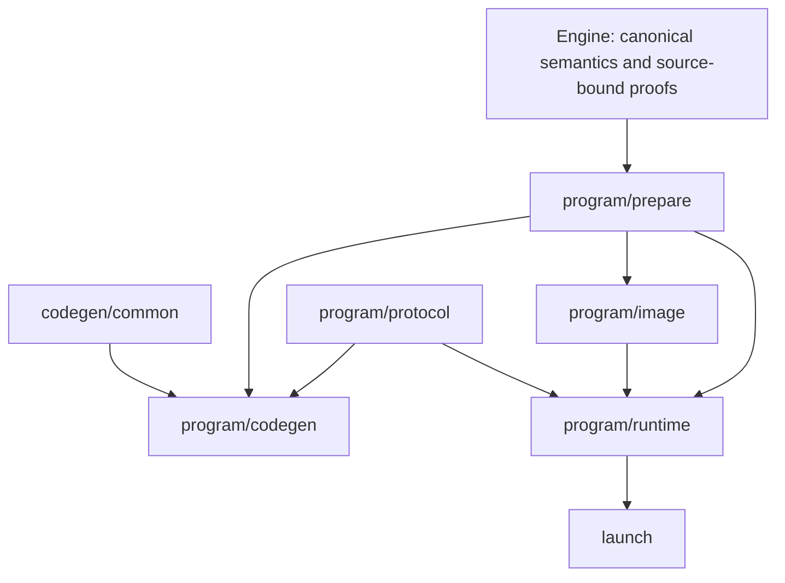

# Native compiler consolidation

This is the implementation contract and migration ledger for the consolidation
above PR #934. The public source/bytecode → canonical `ProgramArtifact` → checked
native plan → shared JIT/Object definition path remains authoritative. Supported
scalar, match, iteration, managed, hosted, benchmark-policy and source-native
entry points remain supported. No stack is merged by this work.

## Fixed baseline and evidence

The handoff proposed I = `96e535307b30a69fa2dc8dd48c2192089e2361ea`.
Before any cleanup measurement, adopt I =
`8aafe1e16b50b333d7990dd107e79124405bb71b`, PR #934's rebased head.
This preserves the subsequent test-only packed-frame gating fix and the merged
#901–#910/#929 integration changes. The rebase preserves all 213 optimization
commits. This I is fixed throughout the campaign; F/I measures only this cleanup.

W remains `d8d9a7d64944cd3de78fe3f8190284924069c508`. Its retained executable
SHA256 is `43ec6990256fec678e99bc7726ce2f203a4191154e19963fee4a43b355fc70ca`;
its object SHA256 is `a45687cbcb1d8824a1de595545192e14b075462e309cbd3796286f04b1667f4c`.
Historical evidence is benchmarks commit
`0014c0b238f43175c1993ad53f3467e2545c1a93`, under
`experiments/mech/native-owner-aot-v1/`. Historical results qualify W only.
No timing result, test count, or ABI/resource equivalence is inferred for I or F.

The final evidence study is `native-architecture-consolidation-v1/` in that
benchmark root. The two-session, four-subject Williams schedule, seed
2026102595, 20,000-resample paired median log-ratio analysis, and upper 95%
interval gates (F/I < +1%, F/W < +1%, F/R < 0%) must be committed before samples.
Absent the exact retained W/R binaries or recorded machine, performance remains
unqualified; substitutes must never be relabeled as retained controls.

## Dependency and authority graph

Engine proofs have private constructors and no public Deserialize. Read-only
same-plan facts share graph primitives, not consumer eligibility. Runtime image
restoration is an independent checking boundary; neither a serialized proof,
codegen report nor numeric footprint grants execution authority. Runtime-only
code never imports Cranelift, JIT, Object emission or parsing. Common emission
never depends on a packed-map strategy. Session orchestration never probes maps
or performs compiler analysis. Representation modules never own global dispatch.

## Preparation and work

One owned `PreparedNativeProgram` will hold `ProgramMetadata` and complete
text-line frontiers. Its private fields are exposed by typed shared accessors.
CodePlan keeps distinct scalar and prepared-program variants. Emission borrows
preparation; descriptor finalization hashes complete inventories, then moves
metadata without cloning the plan. Source-backed reconstruction uses the same
preparer; build-owned restoration does not rerun it or bind calls twice.

The ordered recipe is: revision/current-visit validation; aggregates;
parallel/retirement; completion allowance; borrowed strings; string-map inventory
and selected joins; line matrices; body/charged visits and join funding; complete
frontiers and prefix; borrowed/prefix work; map-owner facts/work; closed tails/work;
map admission; actual selected-call binding/query stages; window inventory;
frame prefix/one owner relocation; frozen maps; types/constants/ownership bounds.
Compile host/target and bounded counts are checked before substantial preparation.

Three quantities remain distinct:

- Analysis visits have zero completion **base**; selected joins may add 64 there.
- Charged visits have completion base `64 * outputs + 8 * iterations + 256`,
  plus existing ordered source-bound supplements.
- Emitted instruction bounds preserve primitive precedence, helper operands and
  borrowed/tail/prefix additions; they are not charged runtime work.

Checked addition and validation order remain explicit. Completion sites never
enter map admission. Frame assignment retains scalar + iteration + aggregate +
borrowed + closed words, then relocates owner words once. Unselected frontiers
remain in the identity transcript.

## Runtime and protocols

One ExecutionState will own control, arena, collections/maps, retained calls,
caches, stats and cursors. ControlState is shared mechanically with iteration
execution. Invocation borrows state and disjoint transport lanes synchronously.
`Prepared.state` remains optional: take before admission, invoke, validate and
clear loans, restore the same state only on success. Every error after take is
terminal. No restore-on-error guard, state clone, lock, RefCell or guest dispatch
is introduced. Drop map/line/collection owners before arena, and backing before
the reservations paying for it. Mutable frame-lane references never span native
execution. Packed frames retain stable Box addresses and refreshed export slots.

Map Slot keeps its three Option-backed fields and existing charged envelope.
Named transitions represent Vacant, Retained, Closed, FrozenPending and
FrozenPublished; terminal cleanup-only partial storage never resumes. Closed map
modes 0/2/3 remain distinct from scalar tail modes 1/4. `has_retained_binding`
preserves the former `active` predicate; occupied and active-table counts differ.

Global helper tags and closed-owner operations have separate typed domains.
Owner IDs 0–14, global IDs 0/1/2/output range and MAX-1 through MAX-25 retain
numbers, ignored lanes, debit/validation order and error origins. MAX-15 is live
StructuralObservation. Naming tags grants no new precise memory-effect proof.

Descriptor serialization remains explicitly flat. Preserve image format
`mech.build-owned-native-descriptor` v1, typed IR 94, work 69, program ABI 33,
192-byte identity, offsets 112/120 for same-Object footprint and all frame
offsets/symbols. `constant_admission_bytes` remains a recomputed nonserialized
cache. Proof DTOs belong to image/wire, with independent frozen-map and
selected-join association checks. No version bumps or resource repricing.

## Migration/deletion ledger

| Stage / authority | Current and duplicate owners to replace | Production callers / feature scope | Required evidence / final owner |
| --- | --- | --- | --- |
| B preparation | `iteration_compiler::define_cfg` setup; `NativeProgramDescriptor::prepare`; layout aggregate/owner rediscovery | Program JIT, Object, `program_linked::prepare_descriptor`; program runtime/compiler | One `program/prepare`; source/decoded/image metadata, identity/frame/work agreement; delete both old recipes |
| B cost/frame | compiler zero-completion loops; descriptor charged-completion loops; owner relocation in both | same as preparation | One ordered composition, distinct visit views; emitted bounds unchanged; delete duplicate loops |
| C graph facts | host parallel traversals and engine `fusion_semantics`/private `ValidationInputs` primitives | engine validation/lowering, host layout; runtime preparation | Opaque same-plan facts; counts-first/lazy first errors; role-specific reads/barriers |
| C aggregate emission | `program_scalar_aggregates`; packed-loop aggregate bodies and neutral helpers | memory scalar, SSA scalar/packed codegen; compiler only | `codegen/common`, static WordAccess; overlap, tag/origin and actual-pass ablations; delete duplicate bodies/imports |
| D controls/report | TLS disable flags and `take_*_emissions` | all codegen passes and ablation tests; compiler only | explicit options plus bounded actual-emission report; nested/concurrent isolation; delete TLS/wrappers |
| E execution/stats | `program_runtime::Context`, OwnedState, session transfer mirrors | normal/paused/worker sessions; program runtime | one state/stats owner and borrowed invocation; terminal errors/drop/resource frontiers |
| E control | iteration Context ledger and program/session mirrors | scalar iteration and program hooks; runtime | shared ControlState/View; exact visit/error/order behavior |
| E map lifecycle | scattered Slot field transitions | retained/closed/frozen callers; runtime | maps owner methods with unchanged backing/size; one-short failures, publication/retirement |
| E protocol | `program_abi`, global runtime dispatch, closed owner/codegen numeric tags | every generated helper and synchronous callback | typed `program/protocol`; unchanged ABI, lanes and conservative effects; delete duplicated raw dispatch |
| F launch | repeated scalar/match/iteration and hosted generated main bodies | public generators and generated processes | compiled `launch`, narrow unsafe build binding; runtime closure, all template/public-process tests |
| G namespaces | flat `program_*` module paths | mod/cfg/static CI/unsafe declarations/test paths | move consolidated owners in same commits as path guards; delete temporary private bridges |

Each implementation commit updates this ledger's evidence; pending work is not
completion. No supported alternate API is a deletion target.

## Feature matrix and verification

| Feature | Permitted responsibility |
| --- | --- |
| no default features | no canonical compiler/runtime dependencies |
| canonical-native-runtime | scalar/match/iteration ABI, linked runtime and compiled family launch |
| canonical-native-program-runtime | preparation, image restoration, program state/protocol; no compiler/parser |
| canonical-native-program-host-runtime | hosted resources/provider launch; no resident routing/compiler/parser |
| canonical-native / canonical-native-program / program-host | compiler/JIT/Object and corresponding build/generation APIs |
| optional benchmark policy / native-source | retained separate adapters, never public canonical fallback |

Use pinned nightly-2026-03-03, locked offline dependencies after fetch. Baseline
and final inventories enumerate ignored cases, and execution reports actual
nonempty selections. Retain native unit, native_text_line, workers and catalog
scopes; six scalar-family integration suites and managed Program; source map
contracts; four independent minimal feature checks and dependency inspection.
Reusable fixtures remain small; contract tests stay beside their owner.

Public CLI and hosted qualifications use the existing bounded CI scripts and
saved/pinned harnesses in ci-native-plan.yml. Execute all five CLI unit cases,
all three ignored public-process cases and the ignored original/decoded hosted
process case with their negative controls, receipts and completion checker.
Compare representative emitted guest instruction bodies and resource/identity
outputs with I, not whole host executable bytes. Final changed-input oracle runs
the same exact F and I executables on all seven retained changed inputs.

## Implementation receipts

Stage A fixes I before any samples. At I the current native scope executed
415 passes, 0 failures and 2 existing ignores. These are measured counts, not
copied historical counts. The public CLI built a runnable I AOT executable;
its bytecode is `050db3a016f0caea04900d48940db5bbefc880c3ada507eff82c22c5b84418b0`
and its object is `a45687cbcb1d8824a1de595545192e14b075462e309cbd3796286f04b1667f4c`,
identical to W's retained guest object. Exact W/R executable hashes were verified
without rebuilding either. Benchmark evidence starts at `0ed869eb0` on
`codex/native-architecture-consolidation` in mech-lang/benchmarks.

Stage B replaces the descriptor and compiler preparation recipes with
`program/prepare::PreparedNativeProgram`. Program CodePlan borrows that object;
source-backed linking shares the constructor, while image restoration assembles
metadata through private format DTOs and retains its independent frozen-map and
selected-join checks. Metadata is moved into the descriptor. Flat public
serialization preserves all 25 fields and their order. Complete frontiers and
the string-map inventory are shared with identity, with no hash transcript change.
One ordered supplement composer preserves separate analysis/charged views.
Frame-prefix arithmetic and final local-word lookup have one owner. Static
emission-template bounds remain a separate compiler quantity.

The post-preparation native scope executed 415 passes / 0 failures / 2 ignores.
The subsequent wire/frame changes passed all four existing identity-inventory
checks. The final source/decoded snapshot selection executes one test over four
fixtures: all 32 object/metadata/image/bytecode files match I byte-for-byte.
Program runtime-only compilation, all 90 workflow contracts, unsafe ownership,
warning policy, planning quarantine and build-analysis layout checks pass.
No replaced API is retained as a second preparer. Definition phase extraction
continues alongside explicit compiler context work; the shared JIT/Object path
has not been split into different emitters.

Stages C–H and final qualification remain in progress. The final branch is not
performance-qualified until the prescribed final evidence exists.

Stage C emission: `codegen/common` owns SSA homes, static WordAccess adapters,
Pack/Copy/Project/Observe and ordinary source terminators. Both aggregate bodies
are replaced, including overlap-safe reads before writes. Checked guards emit
the existing checks; packed strategies consume current-site facts and retain
reporting. The scalar strategy uses the shared tag graph directly, with no
packed-emitter import for neutral helpers. The native scope executes 415 passes,
0 failures and 2 existing ignores; all 32 source/decoded snapshot files remain
byte-identical to I. Engine facts work continues separately in this stage.
