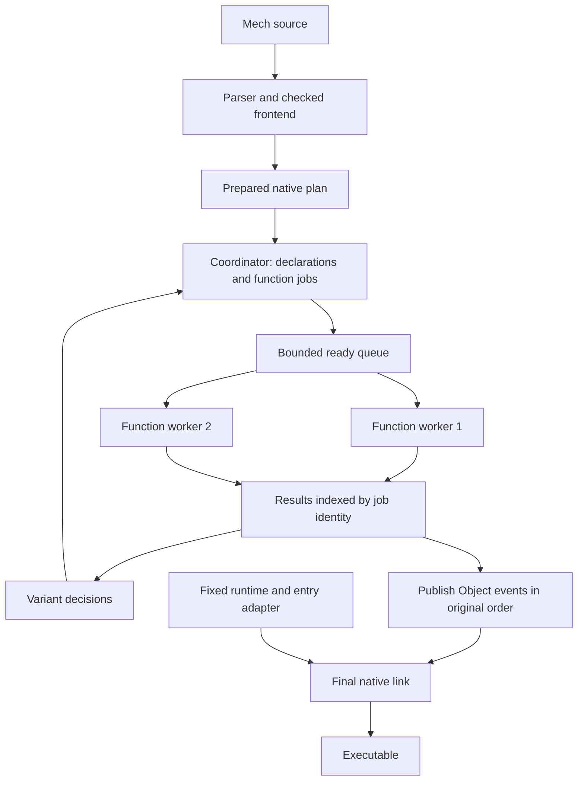

# Parallel compilation of a Mech program

Compile independent native functions concurrently, with one coordinator owning
symbol allocation, shared descriptive tables, variant decisions and ordered
Object publication. Build the fixed runtime/entry adapter independently and
join it with the program Object at the final native link.

This design applies to compiling the level-12 Deflate program into an
executable. Cargo job counts control rebuilding the Rust compiler itself and
do not implement this architecture.

The latest [qualified compiler](native-dimension-pgo-compile-profile.md) compiles
the complete program to an executable in **13.415 seconds** on the Apple M3.
It uses source `ef5e255e81`, native CPU tuning, PGO and two workers. Every
executable byte matches. A separate comparison on that same compiler measures
13.633 seconds serial versus 13.397 seconds with two workers (1.73% faster),
with both balanced blocks improving. PGO counts toward the sub-ten-second goal.

The [expanded implementation on source 0c949505cc](native-parallel-phase-cleanup-compile-profile.md)
now overlaps eligible general numeric-phase cleanup and machine generation with
vector preparation. A real diagnostic records 344 submitted jobs, 48 including
cleanup. The same-binary 0/2 comparison improves complete builds 15.554 to 15.218
seconds (2.16%); a separate old2/new2 comparison improves 1.74%. Every output and
complete executable matches. Default remains serial. IR/proof preparation,
Module effects, variant decisions and ordered publication stay on the coordinator.
Main construction/cleanup and frontend remain serial; the full staged design
below still contains work beyond this implemented boundary.

The earlier [PGO qualification](native-parallel-pgo-compile-profile.md) on source
`0c949505cc` measured 13.597-second complete builds. Its separate worker-count
comparison measured 13.960 seconds serial versus 13.557 seconds with two workers
(2.88% faster). Those observations remain attached to their original source.

The first [integrated implementation](native-parallel-phases-compile-profile.md)
is now qualified with `MECH_COMPACT_COMPILE_THREADS=2` (default `0` stays serial).
It queues 340 real phase Contexts, overlaps machine compilation with later
variant preparation, and records/replays all later Object events in order.
Eight balanced complete builds improve **17.657 to 17.379 seconds (1.57%)**
with the adapter cached; every executable byte matches. A separate eight-run
source-to-Object cohort reduces helper time 5.72% and complete process 0.97%.
The single reversed-direction executable pilot pair and all adverse observations
remain. Main IR construction/cleanup and the frontend remain serial.

The later [updated-compressor qualification](native-refreshed-parallel-compile-profile.md)
uses the larger program and new runtime at `934bde961d`. Eight complete builds
average 19.166 seconds serial versus 19.196 seconds with two workers (+0.16%),
with mixed blocks and identical executables. It establishes no useful parallel
gain on that workload. Default remains serial; the earlier result stays pinned
to its original program/runtime image.

The [allocator/schema-owner compiler comparison](native-current-parallel-compile-profile.md)
uses the retained allocator and schema-owner changes at `12c500108660`.
Eight complete builds average **16.183 seconds serial versus 16.016 seconds
with two workers**, saving **0.167 seconds (1.03%)**, with both blocks faster.
Every output and complete executable byte matches. Only worker count changes;
these results are separate from the earlier cohorts. Default stays serial.

## Current work and limits

The latest [Object cohort](native-dimension-pgo-compile-profile.md) spends
1.510 seconds generating numeric helpers, 1.999 seconds constructing the main
source CFG, and 2.673 seconds cleaning it up, including value compaction.
Internal compilation averages 13.153 seconds. These observations are separate
from the complete-build cohort; nested stage intervals must not be added.

The current Deflate metadata contains 172 numeric phases and 172 vector
candidates, with four no-growth and four composed variants. Forty-four phases
have private nested contracts. The helpers offer parallel work; the large main
function remains a substantial serial dependency. Complete builds need another
3.415 seconds of savings to reach ten seconds.

The implemented loop waits for each general/vector pair before preparing the
next pair. A bounded queue spanning successive pairs is an unmeasured next
candidate. It must retain the original declaration/data/publication order,
variant decisions and first compilation error.

A fresh, separately instrumented compile preserves every program output byte
and records the following work. These counters justify continuing the schema
and cleanup investigations alongside scheduling:

| Work | Count |
| --- | ---: |
| Shared schema materializations through `into_owned` | 43,509 |
| Dimension-declaration entries copied by those materializations | 83,135,976 |
| Raw schema finalizations | 45,645 |
| Pending canonicalization hits / misses | 4,777 / 7,467 |
| SSA nonlocal find calls | 53,081,978 |
| Single-predecessor steps | 103,418,361 |
| Sealed-block sentinels | 20,078,161 |
| Fully cached equal-predecessor opportunities | 264,011 |
| Suffix elements shifted by SSA sentinel removal | 2,140,006 |

Declaration entries include repeated copies of the same environment. Only
about 1.3% of sealed sentinels meet the proposed cached-predecessor case; these
counts do not justify broadening that shortcut. Partial main-cleanup clocks
record ten constant-phi wrapper calls totaling 0.653 seconds, 21 CFG rebuilds
totaling 0.050 seconds and 21 dominator rebuilds totaling 0.086 seconds. Wrapper
clocks include nested verification and are not exclusive algorithm timings.
The built-in Cranelift timing table is empty in this diagnostic; it supplies no
pass timings. Full raw counters and all setup failures are preserved in the
[planning evidence](../../benchmarks/mech-deflate/native-profile/parallel-planning-apple-m3-20261114.json).

Existing phase generation is interleaved:

1. Derive contracts and construct IR.
2. Declare functions, imports and data in a mutable module.
3. Run cleanup and compile machine code.
4. Read code bytes, stack size and code size.
5. Choose variants and construct metadata.

In particular, general and vector machine-code bytes are compared before the
no-growth alternative is selected. `DenseTables` also belongs to the ordered
phase-generation invocation. Concurrency must represent these dependencies.

## Build graph



The first implementation keeps source parsing, checked frontend processing and
native preparation on their current paths. It parallelizes function-local
work after those checks. Independent runtime/adapter preparation can run
alongside the program compilation; a validated prebuilt adapter can be reused.

Start with two workers. Even an ideal two-way split of the entire 2.128-second
helper interval would save only about 1.064 seconds, before coordination costs
and phase barriers. Reaching ten seconds also requires reducing serial frontend,
main-function construction, cleanup and backend work.

## Separate construction, compilation and publication

Introduce explicit internal types rather than requiring every emitter to finish
machine compilation while it owns `&mut Module`:

```rust
struct FunctionJob {
    id: DefinitionId,
    function: cranelift_codegen::Context,
    // Exact ISA shared through OwnedTargetIsa; no mutable Object module.
    isa: cranelift_codegen::isa::OwnedTargetIsa,
    report: PendingReport,
}

struct CompiledDefinition {
    id: DefinitionId,
    context: cranelift_codegen::Context,
    relocations: Vec<cranelift_module::ModuleReloc>,
}

enum Publication {
    DeclareFunction(/* original request */),
    DeclareData(/* original request */),
    DefineData(/* owned description */),
    DefineFunction(DefinitionId),
}
```

These sketches describe the broader pipeline; the implemented boundary is in
[`compile_jobs.rs`](../../hosts/gpu/src/native_artifact/program/compact/compile_jobs.rs)
with owned Context jobs, tickets and an ordered `RecordedModule`. Report
completion remains with the coordinator and reads actual compiled metrics.
Jobs move their
Context into a worker; they do not clone the large function graph. A worker owns
its CFG, dominator tree, optimization state and control plane. It cannot mutate
the Object or a compilation-wide cache.

The existing backend already separates the required operations internally:
`ObjectModule::define_function_with_control_plane` calls `Context::compile`,
collects alignment/code/relocations and publishes the definition.
`Module::define_function_bytes` exposes the publication half. The new boundary
must reproduce this exact alignment and relocation conversion, including the
original function identity.

The backend factory should retain an `OwnedTargetIsa` clone alongside the
Object module. Workers then share the same immutable ISA without borrowing the
mutable coordinator. Rebuilding an ISA independently in each worker is
unnecessary.

Record declaration, data-definition and function-definition events, including
their order. Replay them on the real Object module and assert the expected IDs.
Publishing only functions in order is insufficient if intervening data
definitions affect section or symbol ordering.

A separate [backend boundary probe](native-schema-cache-view-compile-profile.md#parallel-backend-boundary-probe)
now exercises this split on two synthetic functions with local/imported calls,
data references and a function-address data relocation. It retains a data
definition between function publications. Serial `define_function` and one,
two and four workers produce identical complete Object bytes, optimized IR and
compiled metrics in all 24 comparisons. The first standalone link setup fails
on mismatched LLVM bitcode/system LTO; Rust ThinLTO resolves it, with both logs
preserved. This validates the backend API boundary, not Mech phase dependencies,
competing errors, memory limits or a Deflate parallel speedup.

## Make dependencies explicit

Fields known from checked IR, such as entry bounds and packet layouts, can be
available when a job is constructed. Machine-derived fields remain deferred:
code bytes, stack bytes, code size and any decision that consumes them. Do not
fabricate a compiled Context or substitute estimated metrics.

General and vector jobs can compile concurrently after their IR and declarations
are ready. Their comparison is a dependency node. No-growth selection waits for
that node; nested helper choices with machine-dependent inputs get equivalent
dependencies. Error results also flow through this graph.

There are two implementation scopes:

- **First:** compile ready jobs within a phase in parallel, preserving the
  current declaration sequence and choice barriers. Keep `DenseTables` and all
  module mutations with the coordinator. This is the smaller equivalence proof.
- **Later:** overlap different phases across unresolved choices. This needs
  stable logical symbol handles and ordered assignment of final `FuncId` and
  `DataId`. Conditional declarations cannot simply be reserved in the real
  Object: unused reservations would change IDs and output bytes. The logical
  handle layer needs its own single-worker equivalence qualification.

The first scope may expose only two ready jobs at some barriers. Measure its
occupancy before implementing the larger symbol-planning layer. A shared mutex
around the existing synchronous compilation call would serialize the work.

Main entry construction currently consumes selected phase descriptors. Keep
that dependency. Earlier entry work may overlap helper compilation only after
its inputs are explicitly separated from machine-dependent phase choices.

## Scheduling and correctness

Start with two persistent workers and measure one, two and four. Bound both the
number of ready jobs and retained IR. Apply backpressure before constructing
another large Context. Run an oversized job alone rather than adding a new
language or resource refusal. The main function already has a substantial
transient value population; an unbounded queue would trade time for memory.

No worker waits for another job while holding coordinator state. Dependencies
make jobs ready before dispatch. Results carry stable ordinals; the coordinator
reports the original first error and anchor regardless of completion order.
Source checks and per-function verification remain. Workers retain the existing
pass sequence, optimization settings and transformation decisions.

Caches belong to one compilation and the same immutable plan/function owner.
Shared descriptive table requests need one ordered owner; proof outcomes must
not be reused across source visits, factories or ownership contexts. Direct
scalar emission, checked errors, finite admission and runtime accounting remain
on their maintained paths.

## Runtime adapter and final executable

The adapter has its own frozen inputs: Rust toolchain, runtime libraries,
allocator, wrapper source, ABI and linker arguments. Its Rust compilation can
produce reusable native objects without a completed Deflate Object. The final
link joins those objects with the newly compiled program.

Freeze and hash the adapter objects and full native linker inputs. This caches
shared runtime build work; every Mech compilation still performs its current
source analysis, proofs, optimization and program code generation. Measure
first-use adapter preparation, source-to-Object time, final native link and
steady-state source-to-executable completion separately.

The initial frozen adapter compile/link observation is 14.390 seconds while a
separate compiler bootstrap is running. It is not an isolated link measurement
or a source-to-executable timing. Capturing that invocation and retaining its
native objects permits three warm native links of **0.081–0.093 seconds**, all
reproducing the complete 1,878,568-byte executable with SHA-256
`557d0f5ef2b979e01851ae23b5b3944453a0bd9e772d68161be198916ca06c2c`.

Three earlier direct-link attempts changed output metadata and remain in the
evidence. Mach-O `N_OSO` entries include object paths and timestamps. Keeping
the original canonical object paths and using `ZERO_AR_DATE=1` reproduces every
baseline executable byte. A cache must pin these inputs along with the code;
moving the same object contents is insufficient for the current identity gate.
These are link-only observations, not an end-to-end compiler speedup or a
qualified parallel function-compilation result.

Two later, separately measured complete source-to-executable builds take
17.526 and 17.514 seconds using the frozen adapter objects. They include fresh
source analysis, program code generation and Object/metadata writes, Object
handoff and the final native link. Adapter first-use construction is excluded.
They are observations outside the balanced source-to-Object qualification
cohort, not evidence of a parallel compiler improvement.

## Implementation and qualification

1. Finish precise process timing and freeze source, 61 flags, Object, metadata
   and final-link inputs. Preserve the old polling measurements unchanged.
2. Split function compilation/publication and run the new path with one worker.
   Compare every Object and metadata byte against the existing implementation.
   Compare per-function optimized IR with symbol identities resolved.
3. Enable two workers for independent ready jobs. Preserve declaration/event
   order, choice dependencies, cache ownership and first-error selection.
4. Test four workers only after queue occupancy and memory measurements justify
   it. Keep one-worker execution available as a scheduling configuration.
5. Compare complete final executables using the same frozen adapter/linker
   inputs, then run balanced serial timing cohorts with no concurrent builds,
   profiling, tests or archive work. Report memory and adverse observations.
6. Apply representative held-out programs and maintain the pure/reference
   comparisons for scheduler order, dependent variants, imports, data tables,
   relocations and competing errors.

The first machine-compilation worker boundary has a small measured gain. Moving
more helper construction/cleanup into workers and overlapping different phases
still require the dependency and ownership work above. Retain schema reuse and
constant-phi work as separate investigations; substantial serial work remains
before complete compilation can fall below ten seconds.

Relevant implementation boundaries are
[`phases.rs`](../../hosts/gpu/src/native_artifact/program/compact/phases.rs),
[`phase_function.rs`](../../hosts/gpu/src/native_artifact/program/compact/phase_function.rs),
[`emit.rs`](../../hosts/gpu/src/native_artifact/program/compact/emit.rs),
[`backend.rs`](../../hosts/gpu/src/native_artifact/codegen/backend.rs) and
[`compiler.rs`](../../hosts/gpu/src/native_artifact/program/compiler.rs).
